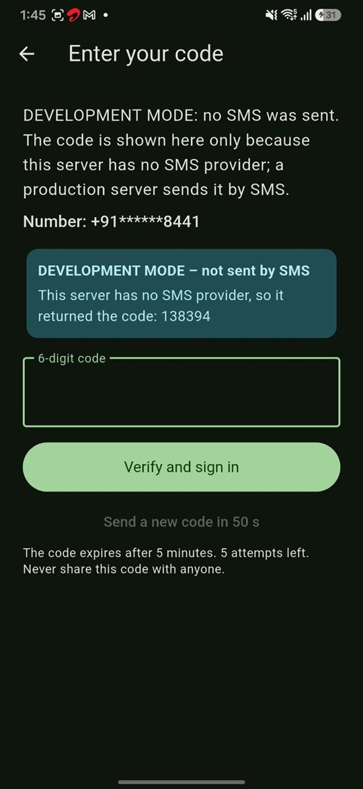
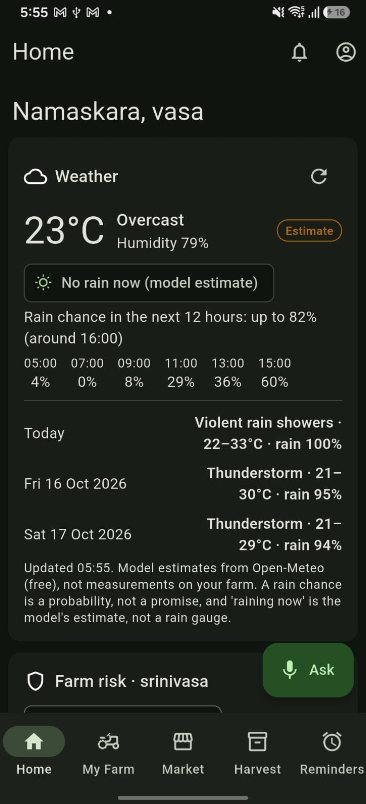
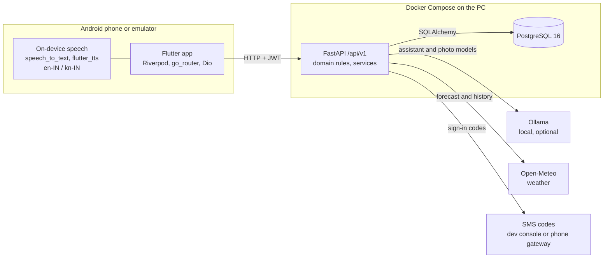
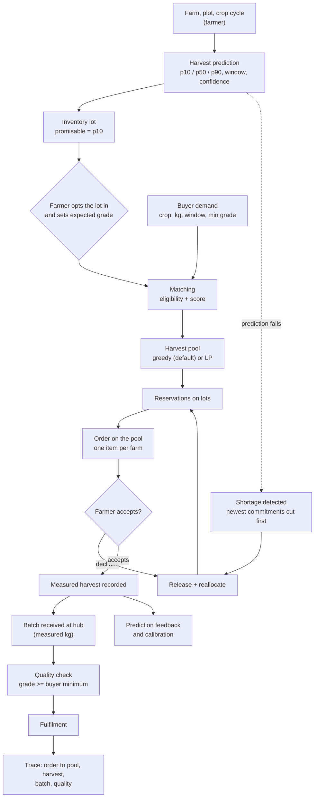
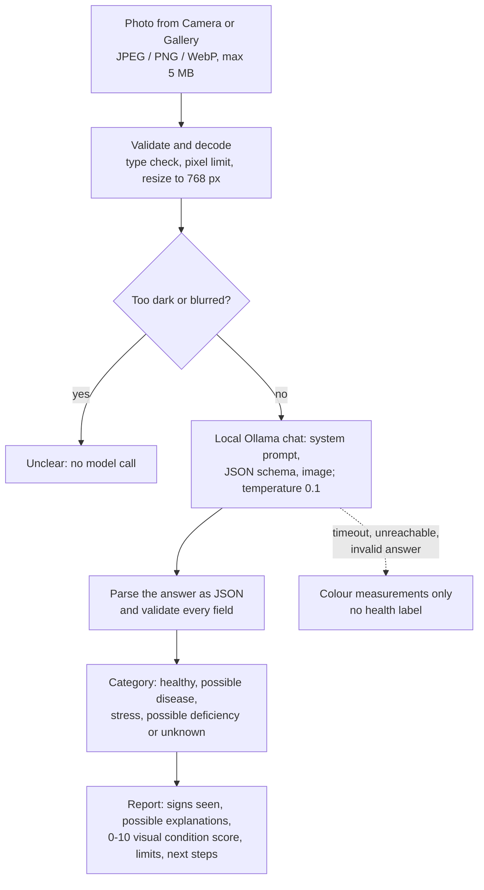

# Harvestique

Harvestique is a farm-to-buyer platform for Karnataka. Farmers record their farms and crops, get uncertainty-aware
harvest predictions, plan income and land use, and offer their **predicted** harvests to buyers. Buyers state a demand
(crop, quantity, delivery window, minimum grade). Harvestique matches that demand against pessimistic (p10) predicted
supply pooled across several farms. When a farm's prediction falls, it detects the shortage and reallocates the gap
to other farms. Delivery is counted only after a measured harvest, a hub quality check and fulfilment.

It is a final-year engineering research project. Its research core is **Dynamic Predictive Harvest Pooling**:
[docs/HARVEST_POOL.md](docs/HARVEST_POOL.md), [docs/ALGORITHMS.md](docs/ALGORITHMS.md).

> **Which branch is this?** This README describes **`main`**, the project as published on 2026-10-15. Newer work,
> including the hosted production setup, is on the
> [`deploy/free-tier-production`](https://github.com/Srinivasabl11/harvestique/tree/deploy/free-tier-production)
> branch and is **not on `main` yet**:
> * password-only sign-in with admin approval;
> * the farmer's A/B/C produce grade;
> * the upgraded crop-health result (item identification and an A/B/C health category);
> * the cloud deployment files ([render.yaml](https://github.com/Srinivasabl11/harvestique/blob/deploy/free-tier-production/render.yaml),
>   [docs/DEPLOYMENT.md](https://github.com/Srinivasabl11/harvestique/blob/deploy/free-tier-production/docs/DEPLOYMENT.md));
> * the seedling branding.
>
> Sections below mark these as **deployment branch only**.
>
> Harvest predictions are **rule-based estimates, not a trained model**. No real-world prediction accuracy has been
> measured yet (see [Evidence and verification](#14-evidence-and-verification)). AI outputs are advisory.

## Contents
1. [Features and their status](#1-features-and-their-status)
2. [Screenshots](#2-screenshots)
3. [Architecture](#3-architecture)
4. [Predicted harvest vs available produce](#4-predicted-harvest-vs-available-produce)
5. [From farm to buyer: the implemented workflow](#5-from-farm-to-buyer-the-implemented-workflow)
6. [Planning tools](#6-planning-tools)
7. [Harvest prediction](#7-harvest-prediction)
8. [AI in Harvestique](#8-ai-in-harvestique)
9. [Quality grading](#9-quality-grading)
10. [Languages and voice](#10-languages-and-voice)
11. [Accounts and security](#11-accounts-and-security)
12. [Run it locally](#12-run-it-locally)
13. [Deployment](#13-deployment)
14. [Evidence and verification](#14-evidence-and-verification)
15. [Limitations and proposed enhancements](#15-limitations-and-proposed-enhancements)
16. [Documentation index](#16-documentation-index)

## 1. Features and their status

"App" means a screen in the Flutter Android app. "API" means a backend endpoint (all under `/api/v1`). The full,
generated endpoint list for `main` is [docs/API.md](docs/API.md) (142 operations).

| Area | What exists on `main` | Where |
|---|---|---|
| Farms, plots, crop cycles | Create and edit farms, plots and crop cycles. Plot land capacity is enforced over time. Expenses, field work and observations can be recorded. | App + API |
| Crop catalogue | 213 standard crops in 18 groups (86 with a Kannada name); admins can add more | API (seeded); app pickers |
| Harvest prediction | p10/p50/p90 quantity, harvest window, confidence, farm risk; prediction feedback and calibration | App (crop screen) + API |
| Income planning | Saved income plans with a full evaluation (cost, income ranges, land use over time, risk, confidence) | App ("Income plans") + API |
| Cost & income calculator, land utilization planner | One-off calculation and a land-split suggestion | **API only** (`/planning/calculate`, `/planning/suggest-allocation`); not in the app |
| Virtual inventory | Each crop cycle has a lot whose promisable quantity is p10 before harvest and the measured quantity after | App ("Harvest") + API |
| Buyer demand and matching | Demands, ranked matches with reasons, search of future supply | App (buyer) + API |
| Harvest pooling and reallocation | A pool reserves supply across farms. When predictions drop or a farmer declines, shortages are detected and replaced. Every change is in an event log and ledger. | App (buyer pool screen) + API |
| Orders, collection, fulfilment | Order on a pool; farmers accept or decline; hub batches, quality checks, fulfilment and traceability | App (buyer, farmer, admin screens) + API |
| Crop health photo check | Advisory analysis of one photo by a local vision model: a most-likely category with category bars, the signs seen and a 0-10 visual condition score; colour measurements only when no model is configured | App + API |
| Farmer's produce grade (A/B/C) | **Deployment branch only.** On `main` the grade is the lot's expected grade set by the farmer, and the hub's measured quality check. | - |
| Farm assistant | Questions answered from the farmer's own records by fixed tools; voice in English and Kannada | App + API |
| Reminders, notifications, calendar | Reminders and an in-app notification feed (no push notifications) | App + API |
| Weather | Open-Meteo forecast and history for farms that have coordinates | App + API |
| Mandi prices | data.gov.in adapter | Off by default (needs a key) |
| Hosted deployment (Render, Neon, Ollama Cloud) | **Deployment branch only.** `main` runs with Docker Compose. | - |
| Payments, contracts, prices on orders | **Not implemented.** Orders carry quantities only. | - |

## 2. Screenshots

All images are genuine screenshots of the Android app, resized for the web but otherwise not edited.

* **Emulator set** (first five images): debug build on the Android emulator, 2026-10-16, test accounts on a
  throwaway local server.
* **Phone set** (everything else): an Android phone, mostly 2026-10-25, signed in with the project author's test
  accounts. All farms, crops, demands and orders are test data. One farm (`f1`, 1 acre), one tomato crop and a
  test buyer ("vasa business").

> **Branch:** both sets come from the **`deploy/free-tier-production`** build, not `main`. On `main` the screens
> have the same layout but show the earlier Karnataka-flag artwork instead of the seedling photo. Screens or
> details marked **deployment branch only** do not exist on `main` (checked against `main`'s app source). The
> crop-health card on `main` shows "Most likely: <category>" with category bars, not the A/B/C card shown here.
>
> **Privacy:** screenshots showing full mobile numbers are not published. That covers sign-in screens with a typed
> number, the admin Testers list and the change-password screen.

**Gallery:** [Sign-in and accounts](#sign-in-and-accounts) ·
[Farmer home and guide](#farmer-home-and-guide) · [Farm, plots and crops](#farm-plots-and-crops) ·
[Predicted supply and the farmer's market](#predicted-supply-and-the-farmers-market) ·
[Buyer: market, demands, orders, traceability](#buyer-market-demands-orders-traceability) ·
[Crop-health photo check](#crop-health-photo-check) ·
[Assistant and voice](#assistant-and-voice) · [Reminders and account](#reminders-and-account) ·
[Admin](#admin)

### Sign-in and accounts

| **Sign-in** (emulator) | **Create account: farmer** | **Create account: buyer** |
|---|---|---|
|  |  |  |
| Phone number and password. | The language chosen here is used by the assistant and voice. The note "The Harvestique team checks each new account" is **deployment branch only**. | Buyers also give a business name and type. The approval note is **deployment branch only**. |

| **Sign-in code (development mode)** |
|---|
|  |
| `main`'s SMS-code step, from an earlier build. Without an SMS provider the development server shows the code on screen. The number is masked by the app. Not in the deployment branch, which removed SMS codes. |

### Farmer home and guide

| **Home: Kannada quote** | **Home: weather** | **Home: farm risk and shortcuts** |
|---|---|---|
|  |  |  |
| One of 100 Kannada quotes. Before a farm exists, Home shows "Get started". | Open-Meteo forecast for a farm with coordinates, labelled as a model estimate, not a measurement. | Farm risk is built from the latest prediction of each crop cycle. |

| **Emulator Home** |
|---|
|  |
| The same screen on the emulator set. |

<details>
<summary><b>First-run guide (11 screens)</b>: shown once after sign-in, reopened from Account → Help &amp; guide</summary>

| 1 Welcome | 2 Farm and plots | 3 Crops | 4 Weather |
|---|---|---|---|
|  |  |  |  |

| 5 Income planner | 6 Expenses | 7 Observations and crop health | 8 Harvest |
|---|---|---|---|
|  |  |  |  |

| 9 Reminders | 10 Orders | 11 Ask Harvestique |
|---|---|---|
|  |  |  |

</details>

### Farm, plots and crops

| **My Farm** | **Farm: weather and risk** | **Farm: plots and crops** |
|---|---|---|
|  |  |  |
| Farms, archived farms and the entry to Income plans (the plan screens themselves are not pictured). | The forecast is marked stale when Open-Meteo is rate-limited. Risk categories without data say "not assessed". | Plots, crop cycles, expenses and field work for one farm. |

| **Crop catalogue** | **Add plot** | **Add expense** | **Add field work** |
|---|---|---|---|
|  |  |  |  |
| 213 crops in English, with Kannada names where available. | Area and irrigation per plot. | Costs per farm or crop. | Work log per farm or crop. |

### Predicted supply and the farmer's market

| **Harvest: predicted vs promisable** | **Supply request from a buyer pool** | **Accepted order** |
|---|---|---|
|  |  |  |
| Only the pessimistic p10 prediction can be promised. The farmer opts the lot in and sets its expected grade. | A pool reserved part of this lot. The farmer must accept or decline. | After accepting, the farmer marks progress (here "Ready"). |

### Buyer: market, demands, orders, traceability

| **Market** (emulator) | **Market: future supply** | **My demands** | **New demand** |
|---|---|---|---|
|  |  |  |  |
| No supply on offer yet. | Uncommitted p10 supply across farms. No prices are shown. | The demand's stage. | Crop, kg, minimum grade, window. |

| **Orders** | **Order detail** | **Order: one item per farm** | **Traceability** |
|---|---|---|---|
|  |  |  |  |
| Confirmed, waiting and delivered kg. | Estimates and measured kg are labelled separately. | The pool spread the order across four farms. | Order → pool → allocation → harvest → batch → quality → fulfilment. |

### Crop-health photo check

> **Deployment branch only:** the A/B/C result card. The analysed photos were product images from a web image
> search, opened from Gallery, and analysed by `gemma4:31b` on Ollama Cloud. Texts are in Kannada because the
> account's language was Kannada. The score is a visual estimate, not a diagnosis.

| **Start** | **Tomato: Category A** | **Mango: Category B** | **Damaged tomato: Category C** |
|---|---|---|---|
|  |  |  |  |
| Camera or Gallery. | A smooth, unblemished tomato. | A speckled mango. | A cracked, damaged tomato. |

| **Groundnut leaf** (emulator) | **Not a crop** (emulator) |
|---|---|
|  |  |
| A public groundnut leaf-spot photo, commit `c9eb9bb`. | The emulator's virtual camera scene: no guess is given. |

### Assistant and voice

| **Kannada: my farms** | **Reminder: confirm** | **Reminder: added** |
|---|---|---|
|  |  |  |
| The answer comes from the farmer's own records. | Writes need confirmation. The reminder title "irrigate a.m" shows the parser's literal reading. | Added only after Confirm. |

| **Kannada: weather tomorrow** | **Kannada: this month's expenses** |
|---|---|
|  |  |
| It says when the stored forecast is old. | From the farmer's expense records. |

The EN / ಕನ್ನಡ switch sets the language. Hold the microphone to speak, or type.

### Reminders and account

| **Reminders** | **Account menu** |
|---|---|
|  |  |
| Suggestions come from the farmer's records. | **Change password** is deployment branch only. |

### Admin

> The bottom bar's **Testers** tab (approving new accounts) is **deployment branch only**. It is not pictured
> because it lists full mobile numbers. `main` has Dashboard, Orders, Quality and Hubs.

| **Dashboard** | **Dashboard: collection and accuracy** | **Orders** |
|---|---|---|
|  |  |  |
| Counts across all users (test data). | Accuracy is measured only from recorded harvests. | All orders and their coverage. |

| **Order: receive batch** | **Cancelled order** | **Traceability: cancelled item** | **Hubs** |
|---|---|---|---|
|  |  |  |  |
| A batch can be received only for an accepted item. | The shortage is shown, not hidden. | Every change is in the ledger. | Collection hubs. |

**Not pictured yet:**
* Income-plan screens.
* The crop screen with its prediction card.
* The buyer's pool screen.
* A hub quality check.
* The notification feed.

## 3. Architecture



| Part | Stack on `main` (verified in this repository) |
|---|---|
| Mobile app | Flutter / Dart for Android: `flutter_riverpod`, `go_router`, `dio`, `flutter_secure_storage`, `shared_preferences` (offline cache), `speech_to_text`, `flutter_tts`, `image_picker` |
| Backend | Python 3.12, FastAPI, Pydantic, SQLAlchemy 2.0, Alembic (15 migrations), PostgreSQL. Business rules are pure Python in `backend/app/domain/`; SciPy (HiGHS) only for the optional LP pool allocator |
| AI | A **local** Ollama server only (`.env.example`: `llama3.2:3b` for the assistant; the photo check is off by default and uses `gemma3:4b` when enabled). There is no setting for a hosted Ollama key on `main` |
| Local development | Docker Compose ([docker-compose.yml](docker-compose.yml)): PostgreSQL, backend, optional Ollama (`--profile ai`) |

The app also contains the **admin** screens: Dashboard, Orders, Quality and Hubs. On an order's detail screen
(opened from Orders) an admin receives batches and fulfils items; quality checks are recorded on the Quality tab.
A user's role decides which screens they see.

## 4. Predicted harvest vs available produce

This distinction runs through the whole system (`backend/app/domain/inventory.py`):

| State of a crop cycle | What the farmer can promise (`committable_kg`) | Label |
|---|---|---|
| Growing, with a prediction | the **p10** (pessimistic) predicted quantity | estimate |
| Growing, no usable prediction | 0 | - |
| Harvest recorded | the **measured** harvest | measured |
| Abandoned | 0 | - |

`available_kg = committable_kg - (active + fulfilled reservations)`, never negative. If commitments exceed what can
now be promised, the excess is the lot's `shortfall_kg` and the lot is *at risk*. A farmer must **opt a lot in**
before any buyer pool can use it, and sets its expected grade.

What a buyer sees as "future supply" (`GET /market/supply`) is the sum of p10 estimates on opted-in lots, not stock
in a warehouse. A reservation against a prediction is **not** a confirmed delivery. Nothing is confirmed until the
farmer accepts, and nothing is delivered until produce is weighed at a hub, quality-checked and fulfilled.

## 5. From farm to buyer: the implemented workflow



| Stage | How it works (verified in code) | Endpoint(s) |
|---|---|---|
| Farm data | Farms, plots, crop cycles; plot capacity checked over time | `POST /farms`, `POST /plots/{plot_id}/crop-cycles` |
| Prediction | Hybrid rule model, new version on each request ([section 7](#7-harvest-prediction)) | `POST /crop-cycles/{cycle_id}/predictions` |
| Offer supply | Farmer opts a lot in and sets an expected grade | `PATCH /inventory/lots/{lot_id}` |
| Demand | Buyer states crop, kg, delivery window, minimum grade, optional location and distance, minimum confidence, maximum risk | `POST /buyer-demands` |
| Matching | Every opted-in lot is checked: same crop; grade at least the minimum; window overlap; available > 0; confidence, risk and distance limits. Each failure has a named reason. Eligible lots get a 0-100 score (confidence, risk, reliability, window fit, proximity, availability). | `GET /buyer-demands/{demand_id}/matches`, `GET /market/harvests` |
| Pooling | Allocates **only `available_kg`** (p10 minus commitments) and reserves it on each lot. Default: greedy by score; optional two-stage LP (risk cap, share cap). Idempotent. | `POST /buyer-demands/{demand_id}/pool` |
| Shortage handling | When a prediction or recorded harvest changes, the exact shortfall is computed and cut from the **newest** pool commitments first (farmers' own reservations are never cut), then replaced from other eligible lots. When new supply appears, short pools are topped up. Each change writes an event and ledger rows. Unresolved gaps leave the pool `at_risk`. | automatic; `POST /pools/{pool_id}/rebalance`, `GET /pools/{pool_id}/events`, `.../ledger` |
| Order and confirmation | An order on a pool creates one item per farm; each farmer **accepts or declines**. A decline releases that supply and reallocates in the same transaction. | `POST /orders`, `POST /participations/{participation_id}/accept`, `.../decline` |
| Harvest | Farmer records the **measured** harvest. This scores every prediction version and updates calibration. | `POST /crop-cycles/{cycle_id}/harvest-actual` |
| Collection | A hub records the weighed batch, only for an accepted item with a recorded harvest | `POST /admin/batches` |
| Quality | Measured check, once per batch: accepted/rejected kg and grade; a grade below the buyer's minimum can only be rejected | `POST /admin/batches/{batch_id}/quality` |
| Fulfilment | Only quality-accepted produce counts; every batch must be checked first | `POST /admin/order-items/{item_id}/fulfil` |
| Traceability | Order to pool to allocation to harvest to batch to quality to fulfilment | `GET /orders/{order_id}/trace`, `GET /trace/batches/{code}` |

A buyer's demand is **not** fulfilled or confirmed because a farmer registered a prediction. The buyer-facing
`stage` moves through matching, `supply_reserved`, `awaiting_farmer_confirmation`, `confirmed`, `in_fulfilment` and
`fulfilled`, or to `partially_matched`, `reallocation_required` or `partially_fulfilled` when supply falls short.

**Limits:** quantities in kilograms only; no prices, contracts or payments; one pool and one order per demand;
reallocation is triggered by events (prediction change, decline, new supply, manual), not on a schedule.

## 6. Planning tools

All planning maths is deterministic Python (`backend/app/domain/planning/`), over **ranges** (low / expected / high)
entered by the farmer. Prices are the farmer's own inputs; Harvestique does not supply market prices.

| Tool | What it computes | Where |
|---|---|---|
| **Income plans** (Farm Income Planner) | A saved plan of crops on an area of land, evaluated fresh each time. Cost per acre and totals (high cost includes an overrun), production, revenue and margin ranges. Also break-even price and yield, land use month by month, income continuity, budget, water and labour checks, risk and confidence scores, and feasibility. A crop can take its yield range from a saved prediction. Plans can be duplicated and compared (2-5). | App "Income plans": `/crop-plans`, `GET /crop-plans/{plan_id}/evaluation`; compare and duplicate are API only |
| **Cost & income calculator** | The same evaluation for an unsaved set of crops | API only: `POST /planning/calculate` |
| **Land utilization planner** | Deterministic greedy split of the available land between candidate crops, limited by land over time, budget, water, labour, demand and per-crop caps; excluded crops come with reasons | API only: `POST /planning/suggest-allocation` |

Formulas: [docs/ALGORITHMS.md](docs/ALGORITHMS.md) section 2. These are planning estimates, not forecasts of income.

## 7. Harvest prediction

The prediction provider is `hybrid-rules` 1.0.0 (`backend/app/domain/prediction/engine.py`), a **deterministic,
documented rule model**. It is not machine learning: nothing in this repository trains a model.

* **Base yield per acre:** an evidence-weighted mean of the farmer's own recorded harvests, the farmer's estimate and
  the catalogue's reference yield. No evidence gives `insufficient_data` (no quantity).
* **Factors:** water deficit, heat-stress days, heavy-rain days (from Open-Meteo), the latest field observation and,
  once at least 5 recorded outcomes exist, a calibration bias.
* **Uncertainty:** a coefficient of variation, widened for missing or stale weather, recent damage and time left in
  the season. p10 / p90 = p50 x (1 -/+ 1.2816 x CV).
* **Window and confidence:** harvest start and end windows, and a 0-100 confidence that is labelled "heuristic,
  not a measured accuracy" until calibration has enough data.
* **Farm risk:** nine categories, each 0-100 or "not assessed" when its data is missing.
* **Feedback:** a measured harvest scores every prediction version (error, interval hit, pinball loss). Calibration
  profiles are versioned and applied only with 5 or more outcomes.

Details and constants: [docs/ALGORITHMS.md](docs/ALGORITHMS.md) sections 3-7.

## 8. AI in Harvestique

### What runs where

| Question | Answer on `main` (verified in code and configuration) |
|---|---|
| Does Harvestique train models? | **No.** There is no training code or ML library in the backend dependencies. |
| What models are used? | `.env.example`: `llama3.2:3b` for the assistant. The photo check is off (colour measurements only) unless `CROP_HEALTH_CLASSIFIER=ollama_vision`, which uses `gemma3:4b`. |
| Where do they run? | Inference only, on a **local** Ollama server through its HTTP API. (Ollama Cloud with `gemma4:31b` is used by the deployment branch.) |
| What is AI-generated? | Assistant wording for general questions; tool choice when the keyword rules fail; the model's description, signs and category for a photo. |
| What is deterministic? | Predictions, risk, inventory, matching, pooling, reallocation, planning, the photo's 0-10 condition score, and the assistant's answers about the farmer's own data. |

### Farm assistant (`backend/app/services/assistant.py`, `backend/app/domain/assistant/`)
* Questions are routed by keyword rules to fixed tools: weather, predictions, farm risk, reminders, inventory, buyer
  opportunities, supply requests, orders, income plans, expenses, crop estimates and suggestions, navigation.
* Answers about the farmer's data come from those tools, never from the model.
* The model may pick a tool when the rules do not understand a question, and may give short, labelled
  general-knowledge answers. Kannada general answers are off by default: the small local models wrote poor Kannada.
  Kannada general questions are first translated with a project glossary.
* Writes (for example recording an expense) need the farmer's confirmation. Allocation requests are always refused:
  only the pool engine allocates.

### Crop health photo check on `main`



* **Result:** a most-likely category with category bars (labelled an AI estimate, not a measured probability), the
  signs the model described, and a structured report with a 0-10 visual condition score when the photo gives enough
  evidence.
* **Safety:** never a diagnosis. Sentences about sprays, chemicals or doses are removed, and spraying is referred to
  an agriculture officer.
* **Privacy:** the photo itself is not stored. Only its SHA-256 and the result are kept.
* **Deployment branch only:** the farmer-facing decision (Healthy, Needs attention, Clearer photo needed,
  Unavailable), item identification against the catalogue, the 0-100 % health score with A/B/C categories, and
  tolerant reading of fenced JSON answers. That last part is needed for Ollama Cloud. See
  [docs/CROP_HEALTH_AND_GRADING.md](docs/CROP_HEALTH_AND_GRADING.md).

### Measured results (local `gemma3:4b`, from the project's evaluation reports, not re-run here)

| Set | Result | Report |
|---|---|---|
| PlantDoc web photos (108) | macro F1 0.82; healthy-leaf recall 0.59 | [docs/CROP_HEALTH_EVAL_2026-10-14.md](docs/CROP_HEALTH_EVAL_2026-10-14.md) |
| Koppal groundnut field photos (20) | macro F1 0.334: healthy leaves were called diseased | [docs/KOPPAL_GROUNDNUT_EVAL_2026-10-14.md](docs/KOPPAL_GROUNDNUT_EVAL_2026-10-14.md) |
| Reserved held-out set (74) | macro F1 0.779 | [docs/CROP_HEALTH_AND_GRADING.md](docs/CROP_HEALTH_AND_GRADING.md) |
| Assistant, 26 Kannada/English questions | 25/26 correct after the glossary (was 14/26) | [docs/ASSISTANT_EVAL_2026-10-14.md](docs/ASSISTANT_EVAL_2026-10-14.md) |

These are small samples. The photo check is a visual estimate that an agriculture officer should confirm. The
condition score is a documented rubric that has not been validated against expert severity ratings.

## 9. Quality grading

On `main` there are two grades, both A/B/C:

* **Expected grade of a lot:** set by the farmer when offering the lot (`PATCH /inventory/lots/{lot_id}`). Matching
  uses it against the buyer's minimum grade.
* **Hub quality check:** the measured grade and accepted/rejected kilograms of a received batch. It decides acceptance
  against the buyer's minimum grade (`POST /admin/batches/{batch_id}/quality`).

The farmer's evidence-based produce grade (checklist plus optional AI photo suggestion) is **deployment branch
only** ([docs/CROP_HEALTH_AND_GRADING.md](docs/CROP_HEALTH_AND_GRADING.md)). Neither grade is an official AGMARK or
BIS grade.

## 10. Languages and voice

* **App screens are in English.** There are no Flutter localization files.
* **Kannada** appears where the server writes the text in the user's language: assistant answers, crop-health
  reports, plus the 100 Kannada quotes on Home. The language is the farmer's profile setting (`en`/`kn`).
* **Voice:** speech recognition and text-to-speech run on the phone (`en-IN`, `kn-IN`). The transcript goes to
  `POST /voice/intent`, the same assistant as chat. Offline use needs the language packs on the phone. Server-side
  speech endpoints answer 503 by design.
* Kannada texts were written for this project and have not been reviewed by a native speaker.

## 11. Accounts and security

* **Roles:** farmer, buyer, admin. Admins are created only from the command line (`app.cli.create_admin`).
* **Sign-in on `main`:** phone number and password (Argon2id) **plus a one-time code by SMS**, at registration and at
  every login. A forgotten password is also reset with an SMS code.
  * `SMS_PROVIDER=dev_console` (the default) writes the codes to the server log for development.
  * `android_gateway` sends them through an SMS gateway app on a phone.
* **Sessions:** JWT access tokens (15 minutes) with rotating refresh tokens, stored in Android's secure storage.
* **Lockout:** a number is locked for 15 minutes after 5 wrong passwords. Code sends and resends are rate-limited.
* **Access control:** every resource route checks ownership and answers 404 for another user's data.
* **CORS:** `CORS_ORIGINS` defaults to `*`; set it for any non-development use.
* **Deployment branch only:** password-only sign-in, admin approval of new testers (Testers screen), request IDs and
  JSON logs, and a per-person limit on AI photo checks.

## 12. Run it locally

Windows 11 with Docker Desktop:

```powershell
copy .env.example .env
docker compose up -d --build
# API docs:  http://localhost:8000/api/v1/docs
# Readiness: http://localhost:8000/api/v1/health/ready
```

Flutter app on the emulator (`10.0.2.2` is the emulator's address for the PC):

```powershell
cd frontend
flutter run --dart-define=API_BASE_URL=http://10.0.2.2:8000/api/v1
```

* **Sign-in codes:** with the default `SMS_PROVIDER=dev_console`, they appear in the backend log
  (`docker compose logs backend`).
* **Without Docker:** [docs/DEVELOPMENT.md](docs/DEVELOPMENT.md) covers the backend virtual environment, a physical
  phone on Wi-Fi, local Ollama and migrations.
* **Demo data:** `python -m app.cli.demo --reset` runs the whole workflow through the real API. It works only on a
  database whose name contains `demo`, and its data is labelled simulated.
* **Tests:** `powershell -ExecutionPolicy Bypass -File scripts\test-backend.ps1` (ruff, mypy, pytest in Docker) and
  `flutter test` in `frontend/`. See [docs/TESTING.md](docs/TESTING.md).

## 13. Deployment

`main` contains only the local Docker Compose setup ([docker-compose.yml](docker-compose.yml)).

The hosted deployment is on the
[`deploy/free-tier-production`](https://github.com/Srinivasabl11/harvestique/tree/deploy/free-tier-production) branch
and is **not on `main`**. It uses the Render free plan, Neon PostgreSQL and Ollama Cloud, with a signed release APK.
See its [render.yaml](https://github.com/Srinivasabl11/harvestique/blob/deploy/free-tier-production/render.yaml) and
[docs/DEPLOYMENT.md](https://github.com/Srinivasabl11/harvestique/blob/deploy/free-tier-production/docs/DEPLOYMENT.md).

## 14. Evidence and verification

| Claim | Evidence level |
|---|---|
| Features, endpoints, algorithms, model names and limits described for `main` | **Verified against `main`** (source, `.env.example`, `docker-compose.yml`, generated [docs/API.md](docs/API.md)) on 2026-10-25 |
| Backend suite 1,834 passed; 969 unit tests and 212 Flutter tests passed | **Test runs on the deployment branch** (commit `c9eb9bb`), 2026-10-16; not re-run on `main` |
| Hosted production API ready; a crop-health check stored with `gemma4:31b` | **Verified on the deployment branch's production setup**, 2026-10-16 and 2026-10-18; not applicable to `main` |
| Screenshots above | **App runs of the deployment branch**: emulator 2026-10-16, Android phone mostly 2026-10-25 (test data); the sign-in code screen is from an earlier build matching `main` |
| Photo-check and assistant accuracy numbers | **Previously reported** in the linked evaluation reports; not re-run |
| Real-world harvest prediction accuracy, income or yield improvements | **Not measured.** No farm has recorded enough harvests in this system. [docs/EVALUATION.md](docs/EVALUATION.md) has a **simulated** calibration study and a simulated pooling experiment only |
| Harvest-pooling algorithm superiority | **Not claimed:** in simulation the LP did not beat greedy reallocation, so greedy is the default |

## 15. Limitations and proposed enhancements

Known limitations of `main`:
* Harvest predictions are rule-based estimates with heuristic confidence until real outcomes accumulate.
* The photo check over-reports problems on healthy leaves in the local evaluations.
* The cost & income calculator and land utilization planner are API only.
* There are no prices, contracts or payments. Mandi prices are off by default.
* Notifications are in-app only. App screens are English only. 127 catalogue crops have no Kannada name.
* Sign-in needs an SMS code. Without a configured SMS sender, codes are only in the server log.

Proposed enhancements (not implemented on `main`):
* Merge the deployment branch: password sign-in with admin approval, produce grading, the upgraded crop-health
  result and the hosted setup.
* Evaluate the vision model on the reserved photo set.
* Have Kannada texts reviewed by a native speaker and add the missing Kannada crop names.
* Expose the calculator and land planner in the app.
* Add push notifications.
* Collect real recorded harvests to measure prediction accuracy and enable calibration.

## 16. Documentation index

| Topic | Document |
|---|---|
| Architecture | [docs/ARCHITECTURE.md](docs/ARCHITECTURE.md) |
| Algorithms | [docs/ALGORITHMS.md](docs/ALGORITHMS.md) |
| Harvest pooling | [docs/HARVEST_POOL.md](docs/HARVEST_POOL.md) |
| AI pipeline | [docs/AI_PIPELINE.md](docs/AI_PIPELINE.md) |
| Crop health and grading (deployment branch features) | [docs/CROP_HEALTH_AND_GRADING.md](docs/CROP_HEALTH_AND_GRADING.md) |
| API (generated) | [docs/API.md](docs/API.md) |
| Database (generated) | [docs/DATABASE.md](docs/DATABASE.md) |
| Evaluation | [docs/EVALUATION.md](docs/EVALUATION.md) |
| Testing | [docs/TESTING.md](docs/TESTING.md) |
| Development setup | [docs/DEVELOPMENT.md](docs/DEVELOPMENT.md) |
| Decisions | [docs/DECISIONS.md](docs/DECISIONS.md) |
| Progress log | [docs/PROGRESS.md](docs/PROGRESS.md) |
