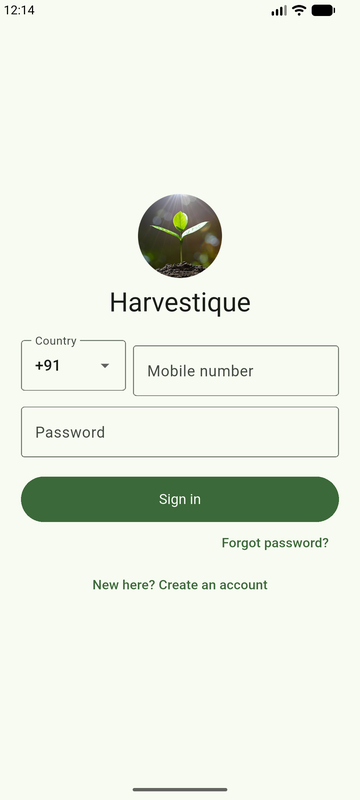
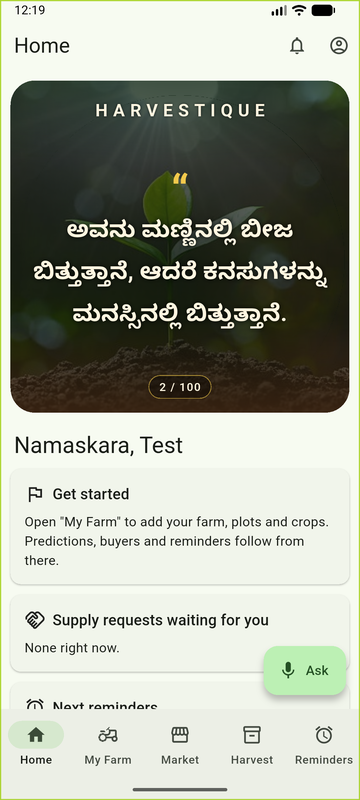
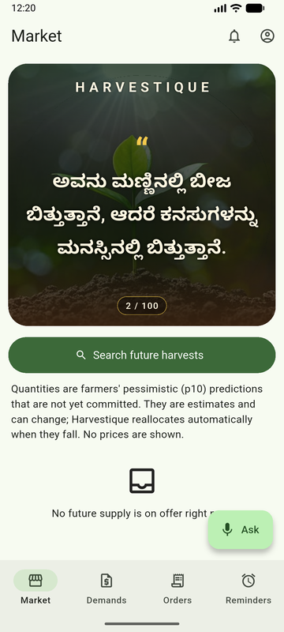
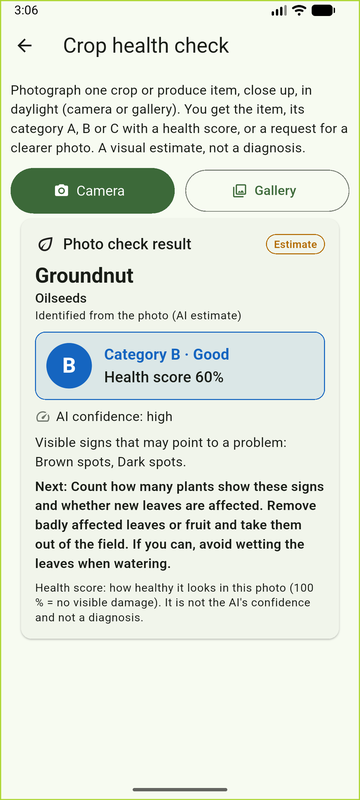
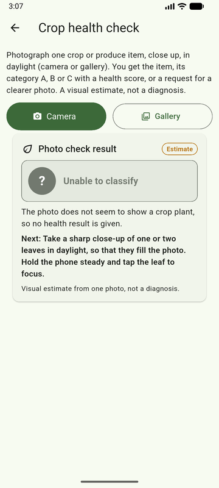
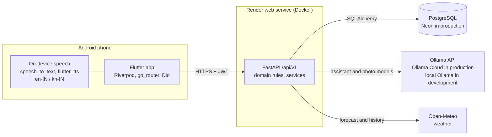
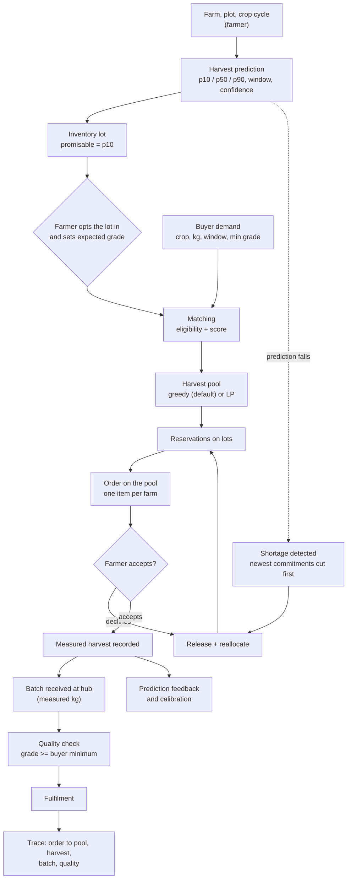
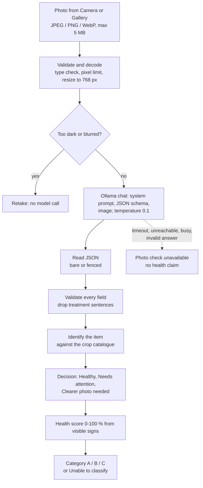

# Harvestique

Harvestique is a farm-to-buyer platform for Karnataka. Farmers record their farms and crops, get uncertainty-aware
harvest predictions, plan income and land use, and offer their **predicted** harvests to buyers. Buyers state a demand
(crop, quantity, delivery window, minimum grade). Harvestique matches that demand against pessimistic (p10) predicted
supply pooled across several farms. When a farm's prediction falls, it detects the shortage and reallocates the gap
to other farms. Delivery is counted only after a measured harvest, a hub quality check and fulfilment.

It is a final-year engineering research project. Its research core is **Dynamic Predictive Harvest Pooling**:
[docs/HARVEST_POOL.md](docs/HARVEST_POOL.md), [docs/ALGORITHMS.md](docs/ALGORITHMS.md).

> **Status, 2026-10-18.** The backend runs on Render (free plan) with a Neon PostgreSQL database. The Android app
> (release 0.6.1) is installed on one test phone. Harvest predictions are **rule-based estimates, not a trained
> model**, and no real-world prediction accuracy has been measured yet (see
> [Evidence and verification](#14-evidence-and-verification)). AI outputs are advisory.

## Contents
1. [Features and their status](#1-features-and-their-status)
2. [Screenshots](#2-screenshots)
3. [Architecture](#3-architecture)
4. [Predicted harvest vs available produce](#4-predicted-harvest-vs-available-produce)
5. [From farm to buyer: the implemented workflow](#5-from-farm-to-buyer-the-implemented-workflow)
6. [Planning tools](#6-planning-tools)
7. [Harvest prediction](#7-harvest-prediction)
8. [AI in Harvestique](#8-ai-in-harvestique)
9. [Quality grading](#9-quality-grading)
10. [Languages and voice](#10-languages-and-voice)
11. [Accounts and security](#11-accounts-and-security)
12. [Run it locally](#12-run-it-locally)
13. [Production deployment](#13-production-deployment)
14. [Evidence and verification](#14-evidence-and-verification)
15. [Limitations and proposed enhancements](#15-limitations-and-proposed-enhancements)
16. [Documentation index](#16-documentation-index)

## 1. Features and their status

"App" means a screen in the Flutter Android app. "API" means a backend endpoint (all under `/api/v1`). The full,
generated endpoint list is [docs/API.md](docs/API.md) (143 operations).

| Area | What exists | Where |
|---|---|---|
| Farms, plots, crop cycles | Create and edit farms, plots and crop cycles. Plot land capacity is enforced over time. Expenses, field work and observations can be recorded. | App + API |
| Crop catalogue | 213 standard crops in 18 groups (86 with a Kannada name); admins can add more | API (seeded); app pickers |
| Harvest prediction | p10/p50/p90 quantity, harvest window, confidence, farm risk; prediction feedback and calibration | App (crop screen) + API |
| Income planning | Saved income plans with a full evaluation (cost, income ranges, land use over time, risk, confidence) | App ("Income plans") + API |
| Cost & income calculator, land utilization planner | One-off calculation and a land-split suggestion | **API only** (`/planning/calculate`, `/planning/suggest-allocation`); not in the app |
| Virtual inventory | Each crop cycle has a lot whose promisable quantity is p10 before harvest and the measured quantity after | App ("Harvest") + API |
| Buyer demand and matching | Demands, ranked matches with reasons, search of future supply | App (buyer) + API |
| Harvest pooling and reallocation | A pool reserves supply across farms. When predictions drop or a farmer declines, shortages are detected and replaced. Every change is in an event log and ledger. | App (buyer pool screen) + API |
| Orders, collection, fulfilment | Order on a pool; farmers accept or decline; hub batches, quality checks, fulfilment and traceability | App (buyer, farmer, admin screens) + API |
| Produce quality grade (A/B/C) | Farmer's grade of a recorded harvest from a checklist, optionally with an AI photo suggestion; the hub's measured check decides acceptance | App + API |
| Crop health photo check | AI vision analysis of one photo: item, parent category, health score, category A/B/C or "Unable to classify" | App + API |
| Farm assistant | Questions answered from the farmer's own records by fixed tools; voice in English and Kannada | App + API |
| Reminders, notifications, calendar | Reminders and an in-app notification feed (no push notifications) | App + API |
| Weather | Open-Meteo forecast and history for farms that have coordinates | App + API |
| Mandi prices | data.gov.in adapter | Off by default and in production (needs a key) |
| Payments, contracts, prices on orders | **Not implemented.** Orders carry quantities only. | - |

## 2. Screenshots

These are genuine screenshots of the Android app (debug build on the Android emulator, 2026-10-16). It was signed in
with test accounts on a throwaway local server. The images are resized but not edited. The test farmer had no farm
yet, so Home shows "Get started", and the buyer Market had no supply on offer.

| Sign-in | Farmer Home | Buyer Market |
|---|---|---|
|  |  |  |

| Crop health: result (Gallery photo) | Crop health: not a crop (Camera photo) |
|---|---|
|  |  |

The crop-health screenshots come from the current code (commit `c9eb9bb`). The photo was analysed by `gemma4:31b` on
Ollama Cloud: a public groundnut leaf-spot photo from Gallery, and the emulator's virtual camera scene.

**No screenshot yet** of crop management, the harvest prediction card, income plans, buyer demands and pools, or
the voice assistant. These screens exist, but they were not captured in a run that could be shown safely here.

## 3. Architecture



| Part | Stack (verified in this repository) |
|---|---|
| Mobile app | Flutter / Dart for Android: `flutter_riverpod`, `go_router`, `dio`, `flutter_secure_storage`, `shared_preferences` (offline cache), `speech_to_text`, `flutter_tts`, `image_picker` |
| Backend | Python 3.12, FastAPI, Pydantic, SQLAlchemy 2.0, Alembic (18 migrations), PostgreSQL. Business rules are pure Python in `backend/app/domain/`; SciPy (HiGHS) only for the optional LP pool allocator |
| AI | Ollama-compatible HTTP API. Development: local Ollama (`llama3.2:3b` assistant; photo check off by default). Production: Ollama Cloud `gemma4:31b` for both |
| Hosting | Render free web service (Singapore), Neon PostgreSQL 18 (Singapore), [render.yaml](render.yaml) |
| Local development | Docker Compose ([docker-compose.yml](docker-compose.yml)): PostgreSQL, backend, optional Ollama (`--profile ai`) |

The app also contains the **admin** screens: Dashboard, Orders, Quality, Hubs and Testers. On an order's detail
screen (opened from Orders) an admin receives batches and fulfils items; quality checks are recorded on the Quality
tab. A user's role decides which screens they see.

## 4. Predicted harvest vs available produce

This distinction runs through the whole system (`backend/app/domain/inventory.py`):

| State of a crop cycle | What the farmer can promise (`committable_kg`) | Label |
|---|---|---|
| Growing, with a prediction | the **p10** (pessimistic) predicted quantity | estimate |
| Growing, no usable prediction | 0 | - |
| Harvest recorded | the **measured** harvest | measured |
| Abandoned | 0 | - |

`available_kg = committable_kg - (active + fulfilled reservations)`, never negative. If commitments exceed what can
now be promised, the excess is the lot's `shortfall_kg` and the lot is *at risk*. A farmer must **opt a lot in**
before any buyer pool can use it, and sets its expected grade.

What a buyer sees as "future supply" (`GET /market/supply`) is the sum of p10 estimates on opted-in lots, not stock
in a warehouse. A reservation against a prediction is **not** a confirmed delivery. Nothing is confirmed until the
farmer accepts, and nothing is delivered until produce is weighed at a hub, quality-checked and fulfilled.

## 5. From farm to buyer: the implemented workflow



| Stage | How it works (verified in code) | Endpoint(s) |
|---|---|---|
| Farm data | Farms, plots, crop cycles; plot capacity checked over time | `POST /farms`, `POST /plots/{plot_id}/crop-cycles` |
| Prediction | Hybrid rule model, new version on each request ([section 7](#7-harvest-prediction)) | `POST /crop-cycles/{cycle_id}/predictions` |
| Offer supply | Farmer opts a lot in and sets an expected grade | `PATCH /inventory/lots/{lot_id}` |
| Demand | Buyer states crop, kg, delivery window, minimum grade, optional location and distance, minimum confidence, maximum risk | `POST /buyer-demands` |
| Matching | Every opted-in lot is checked: same crop; grade at least the minimum; window overlap; available > 0; confidence, risk and distance limits. Each failure has a named reason. Eligible lots get a 0-100 score (confidence, risk, reliability, window fit, proximity, availability). | `GET /buyer-demands/{demand_id}/matches`, `GET /market/harvests` |
| Pooling | Allocates **only `available_kg`** (p10 minus commitments) and reserves it on each lot. Default: greedy by score; optional two-stage LP (risk cap, share cap). Idempotent. | `POST /buyer-demands/{demand_id}/pool` |
| Shortage handling | When a prediction or recorded harvest changes, the exact shortfall is computed and cut from the **newest** pool commitments first (farmers' own reservations are never cut), then replaced from other eligible lots. When new supply appears, short pools are topped up. Each change writes an event and ledger rows. Unresolved gaps leave the pool `at_risk`. | automatic; `POST /pools/{pool_id}/rebalance`, `GET /pools/{pool_id}/events`, `.../ledger` |
| Order and confirmation | An order on a pool creates one item per farm; each farmer **accepts or declines**. A decline releases that supply and reallocates in the same transaction. | `POST /orders`, `POST /participations/{participation_id}/accept`, `.../decline` |
| Harvest | Farmer records the **measured** harvest. This scores every prediction version and updates calibration. | `POST /crop-cycles/{cycle_id}/harvest-actual` |
| Collection | A hub records the weighed batch, only for an accepted item with a recorded harvest | `POST /admin/batches` |
| Quality | Measured check, once per batch: accepted/rejected kg and grade; a grade below the buyer's minimum can only be rejected | `POST /admin/batches/{batch_id}/quality` |
| Fulfilment | Only quality-accepted produce counts; every batch must be checked first | `POST /admin/order-items/{item_id}/fulfil` |
| Traceability | Order to pool to allocation to harvest to batch to quality to fulfilment | `GET /orders/{order_id}/trace`, `GET /trace/batches/{code}` |

A buyer's demand is **not** fulfilled or confirmed because a farmer registered a prediction. The buyer-facing
`stage` moves through matching, `supply_reserved`, `awaiting_farmer_confirmation`, `confirmed`, `in_fulfilment` and
`fulfilled`, or to `partially_matched`, `reallocation_required` or `partially_fulfilled` when supply falls short.

**Limits:** quantities in kilograms only; no prices, contracts or payments; one pool and one order per demand;
reallocation is triggered by events (prediction change, decline, new supply, manual), not on a schedule.

## 6. Planning tools

All planning maths is deterministic Python (`backend/app/domain/planning/`), over **ranges** (low / expected / high)
entered by the farmer. Prices are the farmer's own inputs; Harvestique does not supply market prices.

| Tool | What it computes | Where |
|---|---|---|
| **Income plans** (Farm Income Planner) | A saved plan of crops on an area of land, evaluated fresh each time. Cost per acre and totals (high cost includes an overrun), production, revenue and margin ranges. Also break-even price and yield, land use month by month, income continuity, budget, water and labour checks, risk and confidence scores, and feasibility. A crop can take its yield range from a saved prediction. Plans can be duplicated and compared (2-5). | App "Income plans": `/crop-plans`, `GET /crop-plans/{plan_id}/evaluation`; compare and duplicate are API only |
| **Cost & income calculator** | The same evaluation for an unsaved set of crops | API only: `POST /planning/calculate` |
| **Land utilization planner** | Deterministic greedy split of the available land between candidate crops, limited by land over time, budget, water, labour, demand and per-crop caps; excluded crops come with reasons | API only: `POST /planning/suggest-allocation` |

Formulas: [docs/ALGORITHMS.md](docs/ALGORITHMS.md) section 2. These are planning estimates, not forecasts of income.

## 7. Harvest prediction

The prediction provider is `hybrid-rules` 1.0.0 (`backend/app/domain/prediction/engine.py`), a **deterministic,
documented rule model**. It is not machine learning: nothing in this repository trains a model.

* **Base yield per acre:** an evidence-weighted mean of the farmer's own recorded harvests, the farmer's estimate and
  the catalogue's reference yield. No evidence gives `insufficient_data` (no quantity).
* **Factors:** water deficit, heat-stress days, heavy-rain days (from Open-Meteo), the latest field observation and,
  once at least 5 recorded outcomes exist, a calibration bias.
* **Uncertainty:** a coefficient of variation, widened for missing or stale weather, recent damage and time left in
  the season. p10 / p90 = p50 x (1 -/+ 1.2816 x CV).
* **Window and confidence:** harvest start and end windows, and a 0-100 confidence that is labelled "heuristic,
  not a measured accuracy" until calibration has enough data.
* **Farm risk:** nine categories, each 0-100 or "not assessed" when its data is missing.
* **Feedback:** a measured harvest scores every prediction version (error, interval hit, pinball loss). Calibration
  profiles are versioned and applied only with 5 or more outcomes.

Details and constants: [docs/ALGORITHMS.md](docs/ALGORITHMS.md) sections 3-7.

## 8. AI in Harvestique

### What runs where

| Question | Answer (verified in code and configuration) |
|---|---|
| Does Harvestique train models? | **No.** There is no training code or ML library in the backend dependencies. |
| What models are used? | Production (`render.yaml`): `gemma4:31b` for the assistant and the photo checks. Development defaults (`.env.example`): `llama3.2:3b` for the assistant; the photo check is off (colour measurements only) unless `CROP_HEALTH_CLASSIFIER=ollama_vision` with `gemma3:4b`. |
| Where do they run? | Inference only, through the Ollama HTTP API: **Ollama Cloud** in production (`OLLAMA_BASE_URL=https://ollama.com` with an API key), a **local Ollama** on the PC in development. |
| What is AI-generated? | Assistant wording for general questions; tool choice when the keyword rules fail; the model's description and visible-sign ratings of a photo. |
| What is deterministic? | Predictions, risk, inventory, matching, pooling, reallocation, planning, the health score and A/B/C bands, produce grade rules, and the assistant's answers about the farmer's own data. |

### Farm assistant (`backend/app/services/assistant.py`, `backend/app/domain/assistant/`)
* Questions are routed by keyword rules to fixed tools: weather, predictions, farm risk, reminders, inventory, buyer
  opportunities, supply requests, orders, income plans, expenses, crop estimates and suggestions, navigation.
* Answers about the farmer's data come from those tools, never from the model.
* The model may pick a tool when the rules do not understand a question, and may give short, labelled
  general-knowledge answers. Kannada general answers are off by default: the small local models wrote poor Kannada.
  Kannada general questions are first translated with a project glossary.
* Writes (for example recording an expense) need the farmer's confirmation. Allocation requests are always refused:
  only the pool engine allocates.

### Crop health photo check



* **Item:** the model's crop guess is matched against the catalogue's names, Kannada names and aliases, giving the
  item and its parent category (Vegetables, Fruits and nuts, Cereals and grains, and so on). An unrecognised guess,
  an ambiguous one, or a photo with several kinds of crop gives "Unable to classify". If the check is started from a
  crop cycle, that crop is the item.
* **Health score:** how healthy the plant or produce **looks** in this photo, from the visible signs and their
  extent (100 % = no visible damage). It is not the model's confidence, which is reported separately.
* **Category:** A above 66.66 % (very good), B above 33.33 % up to 66.66 % (good), C 0 to 33.33 % (moderate).
  Scores are clamped to 0-100 and every score falls in exactly one band. Without enough evidence the result is
  "Unable to classify".
* **Safety:** never a diagnosis. Next steps never name a product, chemical or dose, and spraying is referred to an
  agriculture officer. If the model fails, the app says so instead of showing a result.
* **Privacy:** the photo itself is not stored. Only its SHA-256 and the result are kept.

Design note and rules: [docs/CROP_HEALTH_AND_GRADING.md](docs/CROP_HEALTH_AND_GRADING.md).

### Measured results (local `gemma3:4b`, from the project's evaluation reports, not re-run here)

| Set | Result | Report |
|---|---|---|
| PlantDoc web photos (108) | macro F1 0.82; healthy-leaf recall 0.59 | [docs/CROP_HEALTH_EVAL_2026-10-14.md](docs/CROP_HEALTH_EVAL_2026-10-14.md) |
| Koppal groundnut field photos (20) | macro F1 0.334: healthy leaves were called diseased | [docs/KOPPAL_GROUNDNUT_EVAL_2026-10-14.md](docs/KOPPAL_GROUNDNUT_EVAL_2026-10-14.md) |
| Reserved held-out set (74) | macro F1 0.779; 14 of 33 healthy leaves shown "Needs attention" | [docs/CROP_HEALTH_AND_GRADING.md](docs/CROP_HEALTH_AND_GRADING.md) |
| Assistant, 26 Kannada/English questions | 25/26 correct after the glossary (was 14/26) | [docs/ASSISTANT_EVAL_2026-10-14.md](docs/ASSISTANT_EVAL_2026-10-14.md) |

The production model `gemma4:31b` has **not** been evaluated on labelled photos. These are small samples. The photo
check is a visual estimate that an agriculture officer should confirm, and the 0-100 % score and A/B/C bands are a
documented rubric that has not been validated against expert severity ratings.

## 9. Quality grading

There are two separate grades:

* **Farmer's produce grade (A/B/C)** of a recorded harvest (`backend/app/domain/produce_grading.py`). The farmer rates
  every check: size, ripeness or colour, damage and freshness for fresh produce; size, colour, damage, cleanliness
  and dryness for grain and dried produce. The grade is the worst level. An AI photo suggestion is optional, never
  final, and never rates dryness. The farmer may lower the grade with a reason, never raise it. The confirmed grade
  becomes the lot's grade for buyers. Endpoints: `GET`/`PUT /crop-cycles/{cycle_id}/grading`,
  `POST /crop-cycles/{cycle_id}/grading/photo`.
* **Hub quality check:** the measured grade and accepted/rejected kilograms of a received batch. It decides
  acceptance against the buyer's minimum grade.

Neither is an official AGMARK or BIS grade.

## 10. Languages and voice

* **App screens are in English.** There are no Flutter localization files.
* **Kannada** appears where the server writes the text in the user's language: assistant answers, crop-health
  results, grading checks, plus the 100 Kannada quotes on Home. The language is the user's profile setting (`en`/`kn`).
* **Voice:** speech recognition and text-to-speech run on the phone (`en-IN`, `kn-IN`). The transcript goes to
  `POST /voice/intent`, the same assistant as chat. Offline use needs the language packs on the phone. Server-side
  speech endpoints answer 503 by design.
* Kannada texts were written for this project and have not been reviewed by a native speaker.

## 11. Accounts and security

* **Roles:** farmer, buyer, admin. Admins are created only from the command line (`app.cli.create_admin`).
* **Sign-in:** phone number and password (Argon2id). JWT access tokens (15 minutes) with rotating refresh tokens,
  stored in Android's secure storage. No SMS codes.
* **Production sign-up:** new accounts wait for an admin's approval. A number is locked after 5 wrong passwords in
  15 minutes (and after 20 in a day).
* **Access control:** every resource route checks ownership and answers 404 for another user's data.
* **No browser access:** CORS is closed in production; the client is the Android app.
* **Diagnostics:** every response carries `X-Request-ID`. Production logs are JSON and contain no tokens, phone
  numbers or photos.

## 12. Run it locally

Windows 11 with Docker Desktop:

```powershell
copy .env.example .env
docker compose up -d --build
# API docs:  http://localhost:8000/api/v1/docs
# Readiness: http://localhost:8000/api/v1/health/ready
```

Flutter app on the emulator (`10.0.2.2` is the emulator's address for the PC):

```powershell
cd frontend
flutter run --dart-define=API_BASE_URL=http://10.0.2.2:8000/api/v1
```

* **Without Docker:** [docs/DEVELOPMENT.md](docs/DEVELOPMENT.md) covers the backend virtual environment, a physical
  phone on Wi-Fi, local Ollama and migrations.
* **Demo data:** `python -m app.cli.demo --reset` runs the whole workflow through the real API. It works only on a
  database whose name contains `demo`, and its data is labelled simulated.
* **Tests:** `powershell -ExecutionPolicy Bypass -File scripts\test-backend.ps1` (ruff, mypy, pytest in Docker) and
  `flutter test` in `frontend/`. See [docs/TESTING.md](docs/TESTING.md).

## 13. Production deployment

[docs/DEPLOYMENT.md](docs/DEPLOYMENT.md) covers:
* the Render Blueprint, the Neon database and the Ollama Cloud key;
* backups, the admin account and testers;
* the signed release APK (`scripts/build-release-apk.ps1`) and `scripts/verify-production.ps1`;
* what works with the development PC switched off.

Free-tier limits apply. Render sleeps after 15 idle minutes, and the first request then waits about a minute (54 s
measured on 2026-10-18). Neon and Ollama Cloud have monthly quotas. Auto-deploy is off, so deploys are manual.

## 14. Evidence and verification

| Claim | Evidence level |
|---|---|
| Features, endpoints, algorithms, model names and limits described above | **Verified in this repository** (source, `render.yaml`, `.env.example`, generated [docs/API.md](docs/API.md)) on 2026-10-18 |
| Production API ready: database, `llm:ollama` and `vision:ollama-vision` all `ok` | **Verified by a request** on 2026-10-18 (HTTP 200) |
| Backend suite 1,834 passed; 969 unit tests and 212 Flutter tests passed at commit `c9eb9bb` | **Verified by test runs** on 2026-10-16; not re-run for this documentation change |
| Crop health works in production (a real check stored with `gemma4:31b`, no error, report v3) | **Verified by a run** on 2026-10-16 (read-only database check) |
| Screenshots above | **Verified by app runs** on 2026-10-16 (emulator, test data) |
| Release 0.6.1 (signed, `com.example.harvestique`) installed on one Samsung phone and signed in | **Verified on the device** on 2026-10-16 (`adb`, installed APK hash and certificate checked) |
| Photo-check and assistant accuracy numbers | **Previously reported** in the linked evaluation reports; not re-run |
| Real-world harvest prediction accuracy, income or yield improvements | **Not measured.** No farm has recorded enough harvests in this system. [docs/EVALUATION.md](docs/EVALUATION.md) has a **simulated** calibration study and a simulated pooling experiment only |
| Harvest-pooling algorithm superiority | **Not claimed:** in simulation the LP did not beat greedy reallocation, so greedy is the default |

## 15. Limitations and proposed enhancements

Known limitations:
* Harvest predictions are rule-based estimates with heuristic confidence until real outcomes accumulate.
* The photo check over-reports problems on healthy leaves in the local evaluations, and the production model is
  unevaluated.
* The cost & income calculator and land utilization planner are API only.
* There are no prices, contracts or payments. Mandi prices are off in production.
* Notifications are in-app only. App screens are English only. 127 catalogue crops have no Kannada name.
* Production uses free tiers (sleep, quotas) and one server instance.

Proposed enhancements (not implemented):
* Evaluate `gemma4:31b` on the reserved photo set.
* Have Kannada texts reviewed by a native speaker and add the missing Kannada crop names.
* Expose the calculator and land planner in the app.
* Add push notifications.
* Collect real recorded harvests to measure prediction accuracy and enable calibration.
* Capture the missing screenshots listed in [section 2](#2-screenshots).

## 16. Documentation index

| Topic | Document |
|---|---|
| Architecture | [docs/ARCHITECTURE.md](docs/ARCHITECTURE.md) |
| Algorithms | [docs/ALGORITHMS.md](docs/ALGORITHMS.md) |
| Harvest pooling | [docs/HARVEST_POOL.md](docs/HARVEST_POOL.md) |
| AI pipeline | [docs/AI_PIPELINE.md](docs/AI_PIPELINE.md) |
| Crop health and grading | [docs/CROP_HEALTH_AND_GRADING.md](docs/CROP_HEALTH_AND_GRADING.md) |
| API (generated) | [docs/API.md](docs/API.md) |
| Database (generated) | [docs/DATABASE.md](docs/DATABASE.md) |
| Evaluation | [docs/EVALUATION.md](docs/EVALUATION.md) |
| Testing | [docs/TESTING.md](docs/TESTING.md) |
| Development setup | [docs/DEVELOPMENT.md](docs/DEVELOPMENT.md) |
| Deployment | [docs/DEPLOYMENT.md](docs/DEPLOYMENT.md) |
| Decisions | [docs/DECISIONS.md](docs/DECISIONS.md) |
| Progress log | [docs/PROGRESS.md](docs/PROGRESS.md) |
