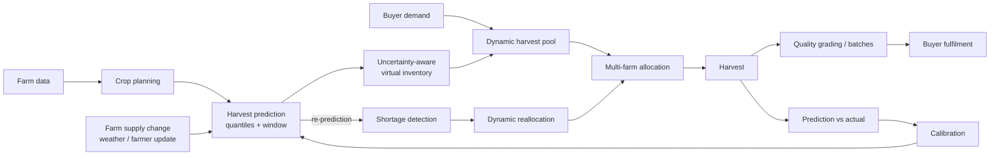
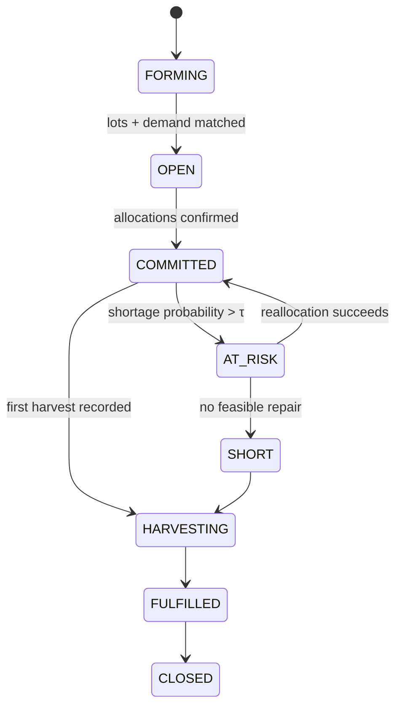

# Harvestique — Technical Architecture

Version 0.4 (Phase 3 implemented) · Status: Phases 0-3 complete (scaffold, identity, farm & crop management, income & land planning). See docs/PROGRESS.md

Harvestique is a predictive agricultural platform connecting farmers and buyers. Its research
contribution is **Dynamic Predictive Harvest Pooling**: buyers commit against *predicted* (not yet
harvested) supply that is aggregated across many farms, with uncertainty modelled explicitly,
shortages detected early, and allocations repaired automatically as farm conditions change.



---

## 1. Backend architecture

**Style: modular monolith with strict layers.** One deployable FastAPI service, internally split by
layer (folders requested for the project) and by bounded context (one module per context inside
each layer). A monolith keeps a final-year project deployable on a laptop while the layer rules keep
it maintainable; contexts can still be extracted later because they only talk through services.

```
backend/app/
  main.py            app factory (create_app) - no import-time side effects
  composition.py     service factories (session + container -> AuthService, ...): one wiring place
                     shared by api/deps.py, the CLI and tests
  cli/               operator commands (python -m app.cli.create_admin)
  core/              config, logging, DB engine/session factory, errors, clock, DI container
  api/               HTTP only: routers, request parsing, auth dependencies, response mapping
    deps.py          dependency providers (the only api module that touches the container)
    v1/<context>.py  one router per bounded context
  schemas/           Pydantic DTOs (Create / Update / Read), separate from ORM models
  services/          use cases; orchestrate repositories + domain + providers; own transactions
  domain/            PURE logic & research algorithms (no I/O, no pydantic - enforced by test). Implemented:
                     farming.py (crop-cycle state machine, dates, land-capacity sweep) and planning/ (income &
                     land planning engine: calculator, scoring, timeline, allocation). Planned: prediction
                     math, pooling, allocation solver, shortage detection, calibration
  repositories/      the only layer that issues SQLAlchemy queries
  models/            SQLAlchemy 2.0 ORM models
  providers/         replaceable adapters to the outside world (weather, LLM, notifications)
```

Dependency direction (enforced by `tests/unit/test_architecture.py`, which fails the build):

```
api ──> services ──> domain
           │  └────> repositories ──> models
           └───────> providers (via Protocols)
```

| Layer | May not import |
|---|---|
| api (except deps.py) | repositories, models, providers, domain |
| services | fastapi, api |
| domain | sqlalchemy, fastapi, httpx, models, repositories, providers, services, api |
| repositories | fastapi, services, api, providers |
| providers | sqlalchemy, models, repositories, core.database, services, api |

**Dependency injection.** `core/container.py::build_container()` is the composition root - the
only place concrete classes are chosen. `api/deps.py` exposes container contents through FastAPI
`Depends`; services receive collaborators through their constructors. Tests replace anything by
building a container with fakes or via `app.dependency_overrides`. No DI framework is needed.

**Transactions.** One SQLAlchemy `Session` per request (`get_db_session`). Services commit
explicitly at the end of a use case; any exception rolls back. Multi-step operations that must be
atomic (e.g. reallocation) run in a single service method.

**Errors.** Services raise `AppError` subclasses (`NotFoundError`, `ConflictError`,
`PermissionDeniedError`, `DomainValidationError`, `ProviderUnavailableError`, ...). A single
handler renders `{"error": {"code", "message", "details"}}`. Routes contain no try/except.

**Background work (Phase 5).** Reallocation, weather refresh and re-prediction run in a separate
`worker` process (same image, different command) that polls a PostgreSQL `jobs` table using
`SELECT ... FOR UPDATE SKIP LOCKED`. Services enqueue jobs inside their own transaction (outbox
pattern), so a job exists if and only if the triggering change committed. No Redis/Celery needed.

**Sync SQLAlchemy.** Endpoints are plain `def` (run in FastAPI's threadpool). The heavy work
(optimisation, simulation) is CPU-bound, so async I/O would add complexity without benefit.

## 2. Flutter architecture

**Feature-first, layered inside each feature; Riverpod for state and DI; go_router for navigation;
Dio for HTTP.**

```
frontend/lib/
  main.dart                 ProviderScope root
  app/                      MaterialApp.router, route table, role-based shells (Phase 2)
  core/
    config/                 --dart-define configuration (API_BASE_URL)
    network/                Dio client, auth interceptor (Phase 2), error-envelope mapping
    errors/                 AppFailure - the only error type widgets see
    theme/                  Material 3 theme
    storage/                secure token storage (Phase 2)
    notifications/          local notification service (Phase 5)
  features/<feature>/
    domain/                 immutable entities, value objects
    data/                   abstract repository + HTTP implementation + its Riverpod provider
    presentation/           screens, widgets, controllers (Notifier/AsyncNotifier)
```

- Widgets depend on **abstract repositories** through providers; tests override providers with
  fakes (`ProviderScope(overrides: ...)`) — see `test/features/system_status/`.
- **Two role shells**: Farmer (farms, crop plans, predictions, pool contributions, harvest entry)
  and Buyer (demands, pool status, allocations, fulfilment). go_router redirects on auth state/role.
- **Offline tolerance:** farmers may have weak connectivity. Read screens cache last response;
  write actions carry an `Idempotency-Key` so retries are safe (Section 4).
- **Notifications:** the app polls `/notifications?since=` on resume and periodically via
  WorkManager (~15 min Android minimum) and raises **local** notifications. No paid push service.
- **Localisation:** English first; Kannada strings via `flutter_localizations` + ARB files (Phase 9).
- **Network for development:** emulator → `http://10.0.2.2:8000/api/v1`; physical phone → the PC's
  LAN IP. Debug manifest allows cleartext HTTP; release builds must use HTTPS.

## 3. Database architecture

PostgreSQL 16, SQLAlchemy 2.0 typed models, Alembic migrations. Conventions:

- **UUID primary keys** (generated in Python), `created_at`/`updated_at` `timestamptz`, all times UTC.
- **Quantities** `NUMERIC(14,3)` in **kg**; money `NUMERIC(12,2)` INR. Never floats in the DB.
- **Enums** stored as `VARCHAR` + `CHECK` (non-native enums) — easier migrations than PG enum types.
- **Deterministic constraint names** (naming convention in `models/base.py`) → reviewable migrations.
- **Optimistic locking** (`version` column) on rows edited concurrently: pools, allocations.
- **Append-only history for research traceability**: predictions are never updated — a new
  version row supersedes the old one; allocation changes are written to an event ledger. This is
  what lets you later reproduce *why* the system made each decision.
- Lat/long as `NUMERIC(9,6)`; PostGIS is deliberately not used (distance via haversine suffices).

Planned tables by bounded context (created phase by phase, not in Phase 0):

| Context | Tables | Notes |
|---|---|---|
| Identity ✔ | `users`, `farmer_profiles`, `buyer_profiles`, `refresh_tokens`, `login_attempts` | role ∈ farmer/buyer/admin; profile tables are 1:1 with users |
| Farms ✔ | `farms`, `farm_plots` | owner, location, area (acres); plot soil + irrigation; `is_active` archive flag |
| Crops ✔ | `crops`, `crop_cycles` | global catalog (name, category, typical duration, season); a cycle = one crop on one plot. *Planned later:* varieties, yield/water attributes, crop plans |
| Planning ✔ | `crop_plans`, `crop_plan_items` | saved *scenarios*: constraints (land, budget, water, labour, season) + crops with ranges/costs. Only inputs are stored; results are recomputed on demand. Items cascade with their plan |
| Farm records ✔ | `farm_expenses`, `farm_activities`, `crop_observations` | INR expenses (farm- or cycle-level), work log, field observations (health, stage, estimated loss %) |
| Weather | `weather_daily` | cached Open-Meteo data, keyed by rounded lat/lon + date |
| Forecasting | `prediction_runs`, `harvest_predictions`, `model_versions` | quantiles p10/p50/p90, window start/end, features JSONB, supersedes_id |
| Inventory | `virtual_inventory_lots` | derived from latest prediction; committable qty per service level |
| Demand | `buyer_demands` | crop, min grade, qty, delivery window, location, price, priority |
| Pooling | `harvest_pools`, `pool_contributions`, `allocations`, `allocation_events` | state machines + ledger |
| Harvest | `harvest_records`, `batches`, `quality_assessments` | actual qty, grade, batch codes |
| Fulfilment | `fulfilments`, `fulfilment_items` | batch → allocation matching, partial fills |
| Calibration | `prediction_outcomes`, `calibration_profiles` | residuals, coverage, conformal offsets |
| Platform | `notifications`, `jobs`, `audit_log`, `idempotency_keys` | outbox / feed / audit |

## 4. API architecture

- **REST, JSON, versioned** under `/api/v1`. OpenAPI at `/api/v1/openapi.json`, Swagger UI at `/api/v1/docs`.
- Resource-oriented plural nouns; actions that are not CRUD use explicit sub-resources:
  `POST /pools/{id}/allocate`, `POST /pools/{id}/reallocate`, `POST /plots/{id}/supply-updates`.
- **DTOs**: `XCreate`, `XUpdate`, `XRead` Pydantic models; ORM objects are never returned.
- **Errors**: one envelope `{"error":{"code","message","details"}}` with stable machine codes.
- **Pagination**: `?limit=&offset=` → `{"items","total","limit","offset"}` (`schemas.common.Page`).
- **Idempotency**: `Idempotency-Key` header on POSTs that create commitments (demands, harvest
  records) — mobile retries must not double-commit produce.
- **Concurrency**: mutable pool/allocation resources expose `version`; stale writes → `409 conflict`.
- Planned route groups: `auth`, `users`, `farms`, `plots`, `crops`, `crop-plans`, `weather`,
  `predictions`, `inventory`, `demands`, `pools`, `allocations`, `harvests`, `batches`,
  `fulfilments`, `notifications`, `analytics` (prediction-vs-actual, calibration), `admin/simulations`, `health`.
- Implemented now: health, the identity endpoints in §5, and the farm & crop management endpoints in §4.1.
- Validation errors are field-level (`details.errors[] = {field, message, type}`) and **never echo the submitted value** (so rejected passwords cannot leak into responses or logs).

### 4.1 Farm & crop management API (implemented in Phase 2)

All farmer routes require the `farmer` role (401 anonymous, 403 buyer/admin — roles are strict).
Every query is scoped to the caller: **a resource owned by someone else is a 404, never a 403**, so
existence is not revealed. Crop-catalog reads are open to any authenticated user; writes are admin-only.

| Resource | Endpoints |
|---|---|
| Crop catalog | `GET /crops` (`search`, `category`, admin: `include_inactive`) · `GET /crops/{id}` · admin: `POST /crops` · `PATCH /crops/{id}` · `DELETE /crops/{id}` |
| Farms | `POST/GET /farms` (`include_archived`) · `GET/PATCH/DELETE /farms/{id}` |
| Plots | `POST/GET /farms/{id}/plots` · `GET/PATCH/DELETE /plots/{id}` |
| Crop cycles | `POST/GET /plots/{id}/crop-cycles` · `GET /farms/{id}/crop-cycles` · `GET/PATCH/DELETE /crop-cycles/{id}` (`status` filter) |
| Expenses | `POST/GET /farms/{id}/expenses` (`crop_cycle_id`, `category`, `date_from/to`) · `GET/PATCH/DELETE /expenses/{id}` |
| Activities | `POST/GET /farms/{id}/activities` (`plot_id`, `crop_cycle_id`, `activity_type`, `date_from/to`) · `GET/PATCH/DELETE /activities/{id}` |
| Observations | `POST/GET /crop-cycles/{id}/observations` · `GET/PATCH/DELETE /observations/{id}` |

**Validation rules (all enforced in services/domain *and* backed by DB `CHECK`/`UNIQUE`/FK constraints):**

| Rule | Error (HTTP / code) |
|---|---|
| Areas, amounts > 0; ≤ 3 dp for acres, 2 dp for money; loss % in 0–100; lat/lon in range and paired | 422 `request_validation_error` |
| A plot cannot exceed the farm, **and all plots together cannot exceed the farm** | 422 `plot_area_exceeds_farm` / `plots_exceed_farm_area` |
| A farm cannot shrink below its plots; a plot cannot shrink below the land its cycles use at once | 422 `farm_area_below_plots` / `plot_area_below_cycles` |
| Cycle crop must exist and be active; cycle area ≤ plot | 422 `crop_not_found` / `crop_inactive` / `cycle_area_exceeds_plot` |
| Land in use at any one moment ≤ plot area (cycles may overlap in time if areas fit) | 422 `plot_capacity_exceeded` |
| Dates: expected harvest after sowing; actual harvest only when harvested and not before sowing; growing/harvested cannot have a future sowing date; no future-dated expenses/activities/observations; no observation before sowing | 422 `expected_harvest_before_sowing`, `actual_harvest_*`, `sowing_date_in_future`, `*_in_future`, `observation_before_sowing` |
| Status only moves forward (planned → growing → harvested; planned/growing → abandoned); closed cycles are read-only; a cycle's crop and plot are immutable | 409 `invalid_status_transition` / `cycle_closed`; 422 for immutable fields |
| Records may only reference the **same farm's** plots/cycles; an activity's plot and cycle must agree | 422 `crop_cycle_not_in_farm` / `plot_not_in_farm` / `cycle_plot_mismatch` |
| Unique names: farm per owner, plot per farm, crop globally (case-insensitive) | 409 `farm_name_taken` / `plot_name_taken` / `crop_name_taken` |
| Parents with children cannot be deleted (archive with `is_active=false` instead); archived farms/plots accept no new children | 409 `farm_not_empty` / `plot_not_empty` / `cycle_not_empty` / `crop_in_use` / `farm_archived` / `plot_archived` |

**Conventions.** PATCH is a partial update: an omitted field is untouched, an explicit `null` clears a
nullable field, and `null` on a required field is a field-level 422. Quantities are exact `Decimal`s in
the service/DB and plain JSON numbers on the wire. Area unit is **acres**, money is **INR**, quantities
(later phases) are **kg**. Concurrent edits are serialised with row locks (farm, then plot — always in
that order) so two simultaneous requests cannot over-allocate land.

### 4.2 Farm income & land planning (implemented in Phase 3)

A pure engine in `app/domain/planning/` (no FastAPI, SQLAlchemy or pydantic) turns a plan's inputs into an
**explainable estimate**. Every figure is a **range** (low / expected / high); nothing is a forecast or a
guarantee, and every result carries a disclaimer and its assumptions. Calculations are deterministic and
use `Decimal`; rounding (half-up) happens only when results are built.

**Inputs** — plan: land (required), budget, water, labour, season. Per crop: name or catalog link, area,
sowing date, duration, harvest window, batches (staggered planting) + interval, yield range (kg/acre), price
range (INR/kg, net of selling costs), costs (per-acre seed/fertilizer/pesticide/irrigation/machinery/other,
labour = person-days × wage, fixed cost, overrun %), water need, demand level and quantity, declared risk,
estimate basis (own records / local knowledge / assumption).

**Calculation (per crop; shown to the user in `explanations`)**

| Quantity | Definition |
|---|---|
| cost per acre | inputs + labour person-days × wage |
| expected cost | cost per acre × area + fixed cost |
| high cost | expected cost × (1 + overrun %); overrun defaults to 5 / 10 / 20 % for low / medium / high declared risk |
| production | yield per acre × area (low / expected / high) |
| sold quantity | min(production, demand quantity) — surplus earns nothing |
| revenue | sold × price (low × low, expected × expected, high × high) |
| margin | **low** = low revenue − *high* cost · **expected** = expected revenue − expected cost · **high** = high revenue − expected cost |
| break-even | price covering expected cost at expected sales; conservative price (high cost ÷ low sales); yield covering expected cost at expected price; margin of safety |
| plan totals | sums over crops. The plan's *pessimistic* margin assumes every crop fails together, so it is deliberately harsh |

**Time.** A batch occupies land from its sowing day through the **last day of its harvest window**. Revenue
is spread evenly over the harvest-window days and counted in the months those days fall in; cost falls in the
sowing month. Land use is a step function over time, so crops that do not overlap reuse the same acres.

**Constraints and findings.** `feasible` is false only for **hard** findings: `land_exceeded` (peak concurrent
area > available land) and `budget_exceeded` (expected cost > budget). Warnings: `budget_at_risk` (fits only
if costs do not overrun), `water_exceeded`, `labour_exceeded`, `demand_exceeded`, `expected_loss`,
`loss_possible`, `sowing_outside_season`, `crop_season_mismatch`, `income_gap`.

**Income continuity.** Monthly income/cost/net/cumulative net, income months, lead time to first income, gap
months and longest gap, largest-month share, level (`continuous`, `uneven` >50 % in one month, `gapped`,
`single_harvest`), peak funding needed if income is reinvested, and plain-language advice.

**Risk and confidence (0–100, transparent weighted sums — not probabilities).** Every component is returned
with its score, weight and reason.

| Score | Components (weights) | Levels |
|---|---|---|
| crop risk | yield spread .25 · price spread .20 · loss exposure in the worst case .20 · declared risk .15 · demand .10 · season fit .10 | low < 35 ≤ medium < 65 ≤ high |
| plan risk | capital-weighted crop risk .65 · revenue concentration .15 · income gaps .10 · water/labour pressure .10 | same |
| confidence | estimate basis .4 (records 90 / local knowledge 65 / assumption 35) · range tightness .4 · completeness .2 | low < 45 ≤ medium < 70 ≤ high |

**Land Utilization Planner** (`suggest_allocation`): a deterministic **greedy** allocator. It drops crops with
non-positive expected margin per acre, ranks the rest (by margin per acre, or return on cost), then gives each
the most area every limit allows — land (exact, time-aware, including a staggered crop's own overlapping
batches), budget (expected cost), water, labour, demand, a per-crop share cap (per batch) and the crop's own
maximum — and records the **binding limit** for each decision. It is explainable and reproducible, but **not
guaranteed optimal**.

| Endpoint | Purpose |
|---|---|
| `POST /planning/calculate` | stateless cost & income calculator → full result |
| `POST /planning/suggest-allocation` | stateless land allocator → allocations, exclusions with reasons, ready-to-use items, and the evaluated plan |
| `POST/GET /crop-plans` · `GET/PATCH/DELETE /crop-plans/{id}` | saved scenarios (list is summaries) |
| `POST /crop-plans/{id}/items` · `GET/PATCH/DELETE /crop-plan-items/{id}` | crops in a scenario (max 30) |
| `GET /crop-plans/{id}/evaluation` | the plan's result, computed fresh |
| `GET /crop-plans/compare?plan_id=…` | 2–5 plans side by side; an infeasible plan is never named best |
| `POST /crop-plans/{id}/duplicate` | copy a scenario to try a variation |

All are **farmer-only**; another farmer's plan is a 404. **Scenarios are saved even when they exceed land or
budget** (so alternatives can be explored) and are reported infeasible by their evaluation; structurally
invalid input (unordered ranges, non-positive values, missing interval for batches…) is a 422.

## 5. Authentication architecture (implemented in Phase 1)

**Identity.** Phone number (primary, suits farmers) + password; email optional and unique. Phones are
normalised to E.164 (`9876543210` → `+919876543210`) so every spelling of a number is one account. No
SMS OTP (needs a paid gateway). Roles: `farmer`, `buyer`, `admin`.

**Registration.** `POST /auth/register` is a discriminated union on `role` (`farmer` | `buyer`); any
other role — including `admin` — fails validation. Each registration creates the `users` row **and**
its `farmer_profiles`/`buyer_profiles` row in one transaction and signs the user in. Admins exist only
via the operator CLI: `python -m app.cli.create_admin`. Password policy: 8–128 chars, ≥1 letter and ≥1 digit.

**Passwords.** Argon2id (`argon2-cffi`, cost configurable via env). Hashes are upgraded transparently
on login when parameters strengthen. Unknown-phone logins burn an equivalent dummy verification so
response time does not reveal which numbers are registered.

**Access tokens.** Short-lived (15 min) HS256 JWT. Claims: `sub` (user id), `sid` (session id), `role`
(informational only), `jti`, `iat`, `exp`, `iss`, `typ=access`. The algorithm is pinned on decode
(rejects `alg=none`); expiry is evaluated against the injected `Clock`. The app refuses to start in
production with a placeholder or <32-char `JWT_SECRET_KEY`.

**Sessions and refresh tokens.** A *session* is a family of rotated refresh tokens (`family_id` ==
the access token's `sid`). Refresh tokens are opaque 384-bit random strings stored only as SHA-256.
`POST /auth/refresh` rotates: the old token is marked `rotated_at`, a new one issued in the same family.
Presenting an already-rotated token is treated as theft/replay and **revokes the whole session**.

**Per-request verification.** `AuthService.authenticate()` does more than check the signature: it loads
the user (must exist and be active) and confirms the session is still live. Consequences, all tested:
logout ends the session *immediately* (not at access-token expiry); disabling an account blocks its
existing tokens at once; and **the role is read from the database, never trusted from the token**, so
role changes apply instantly. Cost: two indexed lookups per authenticated request.

**Brute-force protection.** `login_attempts` table; 5 consecutive failures for a phone (any phone,
registered or not) → `429 account_locked` with `Retry-After` for 15 minutes; a successful login resets
the counter. Attempts are not recorded while locked, so an attacker cannot extend the lock indefinitely.

**Authorization.** (1) Role guards in `api/deps.py`: `FarmerDep`, `BuyerDep`, `AdminDep`
(`require_roles(...)`) — `401` unauthenticated, `403` wrong role; roles are strict (admin does not
inherit farmer/buyer access). (2) Ownership checks inside services (arrive with farms/demands).
Services receive a `CurrentUser` value object, never the HTTP request.

**Endpoints.**

| Method & path | Auth | Purpose |
|---|---|---|
| `POST /auth/register` | public | create farmer/buyer + profile, returns user + tokens (201) |
| `POST /auth/login` | public | phone + password → user + tokens; 401 / 403 disabled / 429 locked |
| `POST /auth/refresh` | refresh token in body | rotate token pair |
| `POST /auth/logout` | access token | end the current session only (204) |
| `GET /auth/me` | any role | the caller incl. role profile |
| `GET /farmers/me` · `GET /buyers/me` | farmer · buyer | own role profile |
| `GET /admin/users` | admin | paginated user list, `?role=&limit=&offset=` |

**Flutter (Phase 2).** Tokens go in `flutter_secure_storage`; a Dio interceptor attaches the bearer
token and performs a single-flight refresh on `token_expired`. Error codes are stable machine strings
(`invalid_credentials`, `token_expired`, `session_revoked`, `account_locked`, ...).

**Known limitations (deliberate, documented).** No registration rate-limiting yet (only login lockout);
no password-reset flow (needs an out-of-band channel; admin-assisted for now); `login_attempts` rows are
not yet purged; a legitimate double-submit of the *same* refresh token concurrently is indistinguishable
from replay and ends the session.

## 6. Provider architecture

Every external dependency sits behind a `typing.Protocol` in `app/providers/<kind>/base.py`, with
one fake implementation for tests/offline work and one or more real adapters. `providers/registry.py`
maps config values to implementations; selecting an unimplemented adapter fails fast at startup.

| Provider | Protocol | Implementations | Phase |
|---|---|---|---|
| Weather | `WeatherProvider.get_daily_forecast / get_daily_history` | `FakeWeatherProvider` ✔, `OpenMeteoWeatherProvider` | 2 |
| LLM | `LLMProvider.generate / is_available` | `FakeLLMProvider` ✔, `DisabledLLMProvider` ✔, `OllamaLLMProvider` | 8 |
| Notifications | `NotificationChannel.send` | `FakeNotificationChannel` ✔, `InAppNotificationChannel` (DB feed) | 5 |
| Clock | `Clock.now` | `SystemClock` ✔, `FixedClock` ✔ (tests, simulations) | 0 |
| Allocation solver | `AllocationSolver.solve` (domain-level strategy) | `GreedySolver`, `LPSolver` (SciPy HiGHS) | 4 |
| Yield model | `YieldModel.predict` (domain-level strategy) | `AgronomicBaselineModel`, `QuantileGBMModel` | 2 / 7 |

Rules: providers return **immutable dataclasses** (not raw JSON); they use timeouts and translate
transport failures into `ProviderUnavailableError`; weather responses are cached in `weather_daily`
(fewer calls, offline demos, reproducible experiments); real-network adapter tests are marked and
skipped by default.

## 7. AI architecture

AI in Harvestique is three separate engines. **Only the third uses an LLM, and it is advisory.**

**7.1 Forecasting engine (no LLM)** — `domain/forecasting`, orchestrated by `services/prediction`.
- *Baseline (Phase 2):* agronomic model — expected yield = plot area × variety base yield ×
  weather factor (growing-degree-days and rainfall/ET₀ deficit vs crop requirement) × management
  factor. Harvest window = sowing date + variety duration, shifted by accumulated GDD.
- *Uncertainty:* each prediction is a **distribution**, stored as quantiles (p10/p50/p90) plus a
  harvest-window range. Initial spread comes from crop-specific coefficient-of-variation priors.
- *Learning model (Phase 7, when outcome data exists):* gradient-boosted **quantile regression**
  (scikit-learn/LightGBM) behind the same `YieldModel` interface; model versions are recorded so
  every prediction is reproducible.

**7.2 Optimisation engine (no LLM)** — allocation & reallocation (Section 8), deterministic and testable.

**7.3 LLM assistant (Ollama, local)** — explanations and advice in plain language: "why was my
allocation reduced?", crop-plan summaries, harvest-readiness reminders.
- Runs locally via Ollama (`llama3.2:3b` default for 8 GB RAM laptops; `qwen2.5:7b` if a GPU is
  available). No paid APIs.
- **No database access, ever.** A service builds a small, user-scoped *context DTO* from
  repositories → renders a versioned prompt template → calls `LLMProvider.generate()` → validates the
  output against a Pydantic schema → returns it. The LLM never sees SQL, sessions or other users'
  data and cannot trigger writes.
- **The LLM never decides quantities, prices or allocations.** Numbers in explanations are injected
  from computed results; the LLM only phrases them.
- If tool-calling is added later, tools are an allowlist of **read-only service methods** executed
  by our code with the caller's permissions.
- **Graceful degradation:** if Ollama is down or disabled, template-based explanations are returned
  and `/health/ready` reports the LLM as non-critical.
- Honest limitation: small local models are weak at Kannada; Kannada text should use reviewed
  templates first, with LLM output as an optional extra.

## 8. Dynamic Harvest Pool architecture (research core)

All algorithms live in `app/domain/pooling` as pure functions over plain dataclasses, so they can be
unit-tested, property-tested and run in offline simulations without a database.

**8.1 Uncertainty-aware virtual inventory.** For each farm-plot-crop prediction *i*: quantity
distribution *Yᵢ* (quantiles), harvest window *[aᵢ, bᵢ]*, expected grade distribution, and a
reliability factor *rᵢ* from the farm's calibration history. A lot's **committable quantity** at
service level α is the α-lower quantile of *Yᵢ* (e.g. p10 for 90% confidence), scaled by *rᵢ*.

**8.2 Pool formation.** A pool groups lots with the same crop, compatible grade, overlapping
harvest window and within a distance radius of the demand cluster. The pool's supply distribution is
estimated by **Monte Carlo** (e.g. 5 000 samples) from each lot's distribution with a **shared
regional weather shock** (Gaussian copula, correlation ρ by distance) — farms near each other fail
together, so independence would overstate the pooling benefit.

> **Research hypothesis H1 (risk pooling):** at the same service level α, the pool can commit
> more than the sum of individually committable quantities, because idiosyncratic farm risk
> diversifies: `Q_pool(α) ≥ Σ Q_i(α)`, with the gain shrinking as ρ → 1.

**8.3 Multi-farm allocation.** Decision variable *x_fb* = kg from lot *f* to demand *b*. Linear
program (SciPy HiGHS) minimising transport cost (distance × kg) + grade-mismatch penalty +
shortfall penalty, subject to: lot supply ≤ committable quantity; demand satisfied or shortfall
recorded; window compatibility; optional farmer-fairness constraint (minimum share relative to
predicted supply). A **greedy baseline** (nearest-farm-first) is implemented alongside as the
comparison strategy for evaluation.

**8.4 State machines.**

Allocation: `TENTATIVE → CONFIRMED → AT_RISK → (REALLOCATED | CONFIRMED) → FULFILLED | PARTIALLY_FULFILLED | CANCELLED`.

**8.5 Supply change → shortage detection.** Triggers: farmer supply update (pest, flood, early
harvest), new weather data, calibration update. Each produces a new prediction version, then a
`reevaluate_pool` job. Shortage probability `P(S_pool < committed)` and per-allocation
`P(Y_f < x_fb)` are computed from Monte Carlo samples; crossing threshold τ flags `AT_RISK`.

**8.6 Dynamic reallocation (minimal disruption).** Re-solve the LP with existing allocations as
soft constraints: add a churn penalty for every kg moved away from an already-confirmed
farm/buyer pair, so the repair changes as little as possible. Unfillable demand is reported with a
reason. Every change writes an `allocation_events` row (old → new qty, trigger, prediction
versions, solver, objective value) and notifies affected farmers and buyers.

**8.7 Concurrency.** Re-evaluation of one pool is serialised with a PostgreSQL advisory lock on the
pool id plus optimistic `version` checks, so a farmer update and a scheduled refresh can't
produce conflicting allocations.

**8.8 Harvest → fulfilment → calibration.** Actual harvest creates graded batches; fulfilment
assigns batches to allocations (partial fills allowed). Each closed prediction yields an outcome
row: error of p50, interval coverage (was actual within p10–p90?), pinball loss. Calibration uses
**split conformal prediction** per crop/region to widen or narrow future intervals, and a per-farm
bias factor shrunk toward the crop mean (so one bad season doesn't dominate). Calibration profiles
are versioned and referenced by predictions.

**8.9 Evaluation metrics** (computed by simulation in Phase 9): demand fill rate, shortage
frequency, waste/unsold kg, farmer income and its Gini coefficient (fairness), reallocation churn,
p10–p90 coverage, MAPE — compared across **no pooling vs greedy pooling vs optimised pooling**,
with and without calibration.

## 9. Testing strategy

| Level | Scope | Tooling | Runs |
|---|---|---|---|
| Architecture | layer import rules | AST scan (`test_architecture.py`) | every run |
| Domain unit | prediction math, pooling, solver, shortage, calibration | pytest + Hypothesis (property tests: never allocate above committable; quantities conserved; churn ≥ 0) | every run |
| Service | use cases with fakes for providers | pytest, fake providers, `FixedClock` | every run |
| API | routing, auth guards, error envelope | `TestClient` + dependency overrides | every run |
| Integration | repositories, migrations up/down, locking | real PostgreSQL via `TEST_DATABASE_URL` (`-m integration`) | locally + CI |
| Provider contract | Open-Meteo / Ollama adapters | recorded responses via `httpx.MockTransport`; live tests marked `ollama`/network, opt-in | opt-in |
| LLM output | prompt templates → schema validation, no numbers invented | FakeLLM + golden fixtures | every run |
| Simulation | seeded multi-farm scenarios, research metrics | `scripts/simulate.py` (Phase 9), fixed seeds | on demand |
| Flutter | repositories, controllers, widgets | `flutter test`, mocktail, provider overrides; `integration_test` later | every run |

Static checks: ruff (lint + format), mypy `--strict`, `flutter analyze`. Target ≥ 85 % coverage on
`domain/` and `services/`. One command runs everything: `scripts\validate.ps1`.

## 10. Development phases

**Completed**

| Phase | Deliverable | Result |
|---|---|---|
| **0 ✔** | Architecture, scaffold, health checks, validation tooling | layer rules enforced by test |
| **1 ✔** | Backend identity: users + farmer/buyer profiles, JWT + rotating refresh tokens, RBAC, lockout, admin CLI | register/login/logout/me; role guards |
| **2 ✔** | Farm & crop management backend: farms, plots, crop catalog (+ seed), crop cycles, expenses, activities, observations; ownership authorization; validation | 36 new endpoints; 469 tests |
| **3 ✔** | Farm income & land planning: cost & income calculator, land utilization planner, income continuity, risk/confidence, saved scenarios + compare | 14 new endpoints; 883 tests (see docs/PROGRESS.md) |

**Planned work** (the order is decided phase by phase with the project owner; the numbering above is final, what follows is not)

| Work item | Notes |
|---|---|
| Flutter: auth, role shells, farm/plot/cycle screens | deferred; backend contracts above are stable |
| Weather (Open-Meteo adapter + cache) | `WeatherProvider` interface and fake already exist |
| Harvest prediction with quantiles + harvest window | will supply the yield ranges the planner currently takes from the farmer |
| Uncertainty-aware virtual inventory, buyer demand | |
| Dynamic Harvest Pool, multi-farm allocation (greedy + LP) | research core (§8) |
| Supply change events, job worker, shortage detection, minimal-disruption reallocation, notification feed + Android local notifications | |
| Harvest records, quality grading, batches, fulfilment | |
| Prediction vs actual, conformal calibration, quantile ML model, analytics | |
| Ollama advisory explanations with graceful fallback | |
| Synthetic-data simulator, evaluation, Kannada UI strings, hardening | |
